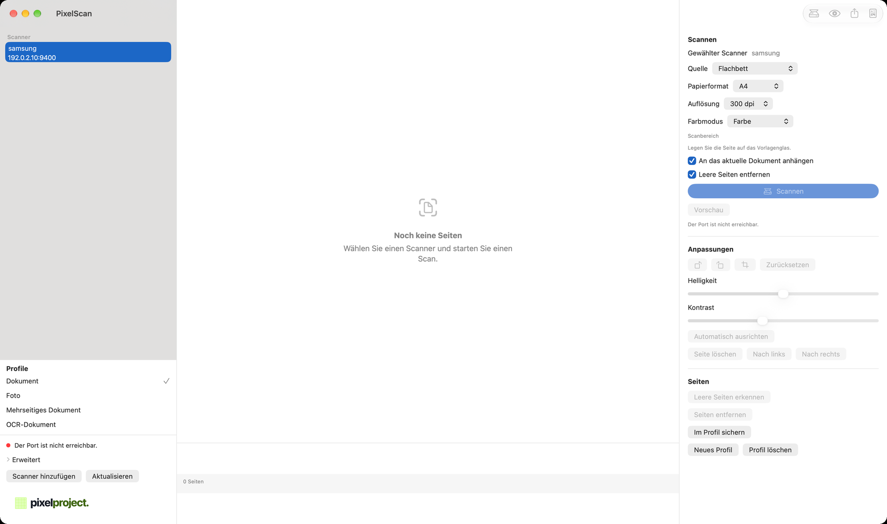
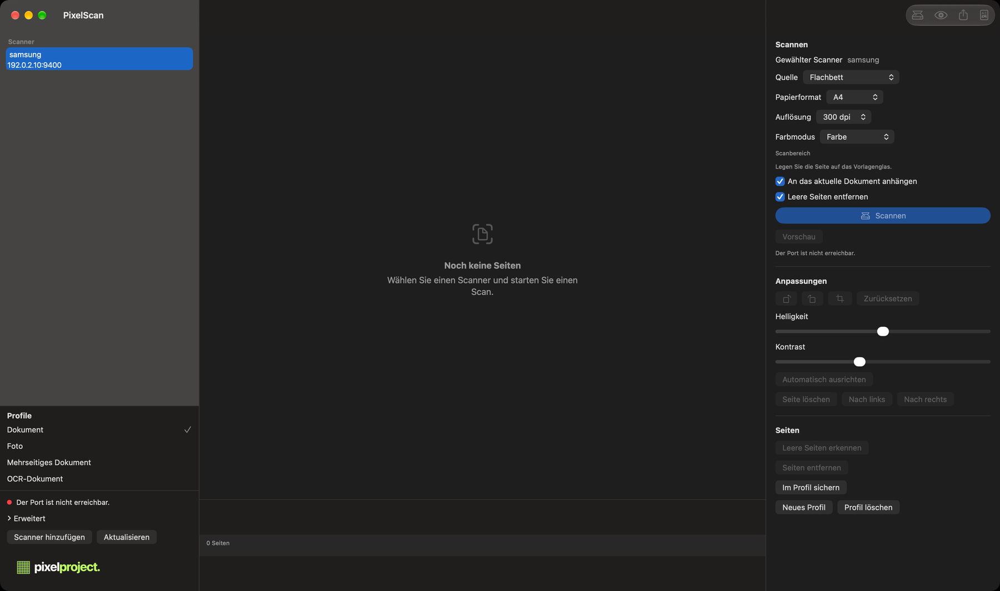

# PixelScan

[English](README.md) | [Deutsch](README.de.md)


<picture>
  <source media="(prefers-color-scheme: dark)" srcset="docs/pixelproject-logo-dark.svg">
  
</picture>

PixelScan ist eine kostenlose, native macOS-Anwendung zum Scannen und Aufbereiten von Dokumenten mit kompatiblen Netzwerk- und Multifunktionsscannern. Seiten, Texterkennung und Exporte bleiben auf dem Mac. Ein Konto, ein Abonnement oder ein Cloud-Dienst ist nicht erforderlich.

PixelScan ist kein Produkt von Samsung Electronics. Samsung ist eine Marke des jeweiligen Inhabers. Das erste praktisch geprüfte Gerät ist ein Samsung-Netzwerkscanner. Die Anwendung ist so gebaut, dass weitere Scannerfamilien ergänzt werden können, sobald ihr Verhalten tatsächlich geprüft wurde.

## Für wen PixelScan gedacht ist

PixelScan ist für Personen, die auf einem Mac Dokumente scannen möchten, ohne Konto und ohne Cloud-Dienst. Es richtet sich an kompatible Netzwerk- und Multifunktionsscanner, beginnend mit älteren Samsung-Geräten, die das SANE-Backend `xerox_mfp` sprechen. Es ist kein Versprechen, dass jeder Scanner jedes Herstellers funktioniert.

## Screenshots

Das Hauptfenster in der hellen Darstellung und im Dunkelmodus. Die Scanneradresse in diesen Bildern ist ein Platzhalter.

**Helle Darstellung**



**Dunkle Darstellung**



## Hauptfunktionen

- Mehrere Scanner speichern und später wieder auswählen
- Angezeigte Scanner über Bonjour finden und eine Adresse von Hand eintragen
- Flachbett und Dokumenteneinzug, wenn der Scanner diese Quelle meldet
- Vorschau, Scanfläche, Auflösung und Farbmodus nur mit den Werten, die das Gerät meldet
- Drehen, Zuschneiden, Helligkeit, Kontrast und eine zurückhaltende Ausrichtung
- Mehrseitiges PDF, PNG, JPEG und TIFF
- Lokale Texterkennung, die ein durchsuchbares PDF erzeugen kann
- Scanprofile für wiederkehrende Aufträge
- Oberfläche auf Deutsch, Englisch, Französisch, Spanisch und Italienisch, mit Umschalter zwischen hellem und dunklem Erscheinungsbild

Eine Funktion erscheint nur, wenn der verbundene Scanner sie meldet. Duplex erscheint zum Beispiel nur, wenn das Backend Duplex meldet.

## Unterstützte macOS-Versionen

PixelScan benötigt macOS 14 oder neuer. Release-Builds sind Universal Binaries für Apple Silicon und Intel. Die aktuelle Entwicklung und der bestätigte Scannertest liefen auf macOS 27 mit Apple Silicon.

## Apple Silicon und Intel

Die Anwendung selbst enthält Code für `arm64` und `x86_64`. Das Scannerprogramm ist getrennt. Auf dem Entwicklungsmac ist Homebrews `scanimage` nur für Apple Silicon installiert, unter `/opt/homebrew/bin/scanimage`. Ein Intel-Mac sucht dieses Programm üblicherweise unter `/usr/local/bin/scanimage`.

PixelScan warnt, wenn die Prozessorarchitektur des Scannerprogramms nicht zur laufenden Anwendung passt. Diese Warnung ist durch einen automatisierten Test abgedeckt. Ein Scan auf einem physischen Intel-Mac wurde nicht ausgeführt. Die Intel-Hardwareunterstützung bleibt deshalb unbestätigt.

## Unterstützte Scanner

Das einzige mit dieser Anwendung praktisch bestätigte Gerät ist der Samsung ProXpress SL-C2670FW, Familie C2670 Series.

- Backend: `xerox_mfp`
- Netzwerk: TCP-Port 9400
- Vom Gerät bestätigt: Flachbett, Dokumenteneinzug und automatische Quellenwahl
- Duplex hat das Referenzgerät nicht gemeldet
- Die Optionen werden vom Gerät gelesen. Die Anwendung erfindet keine Auflösungen und keine Farbmodi

Weitere Samsung-Modelle stehen in der SANE-Konfiguration `xerox_mfp` von sane-backends 1.4.0. Diese Namen stammen aus der Dokumentation des Backends. Sie bedeuten nicht, dass PixelScan mit diesen Modellen gescannt hat. Xerox- und Dell-Namen in derselben Backend-Datei gehören in dieselbe Kategorie: verzeichnet, hier nicht bestätigt.

Kein anderer Hersteller wird als unterstützt bezeichnet. Canon `pixma`, eSCL, AirScan und HP `hpaio` werden in diesem Release nicht als funktionsfähige Scannereinrichtung angeboten.

## Kompatibilitätsstatus

| Status | Bedeutung |
| --- | --- |
| Getestet | Eine Person hat dieses Gerät mit dieser Anwendung oder mit der früheren Fassung unter dem Namen Samsung Scan verwendet und das Ergebnis festgehalten |
| Von SANE dokumentiert | Das Backend nennt das Modell. PixelScan hat es nicht bestätigt |
| Nicht unterstützt | Die Kombination funktioniert nachweislich nicht, oder die benötigte Bibliothek fehlt |

Einzelheiten und die Abgrenzung dieser Zustände stehen in [docs/COMPATIBILITY.de.md](docs/COMPATIBILITY.de.md). Dieselbe Datenbank liegt in der App und wird nicht heruntergeladen.

Der Flachbetttest des SL-C2670FW war am 6. November 2026 ein Ausschnitt von 40 mm × 40 mm bei 75 dpi. Der Dokumenteneinzug wurde vom Gerät gemeldet und früher über die Kommandozeile benutzt. Ein abschließender Einzugstest aus dem PixelScan-Fenster mit eingelegtem Papier ist nicht erfolgt.

## Installation

1. Öffnen Sie `PixelScan-1.3.2.dmg`.
2. Ziehen Sie **PixelScan** in den Ordner Programme.
3. Öffnen Sie PixelScan aus dem Programme-Ordner. Beim ersten Start kann macOS nach der Erlaubnis fragen, Geräte im lokalen Netzwerk zu finden. Erlauben Sie das.
4. Wenn macOS fragt, ob ein Programm eines identifizierten Entwicklers geöffnet werden soll: Das veröffentlichte Image ist mit einer Developer ID signiert und notarisiert. Vergleichen Sie die veröffentlichte SHA-256-Prüfsumme mit genau dieser Datei, bevor Sie eine Kopie aus einer anderen Quelle öffnen.

PixelScan ersetzt eine vorhandene Kopie nicht von selbst. Eine ältere Anwendung mit dem Namen Samsung Scan darf im Programme-Ordner bleiben. PixelScan verwendet die neue Bundle-ID `email.hennige.pixelscan`.

Die vollständigen Schritte stehen in [docs/INSTALLATION.de.md](docs/INSTALLATION.de.md).

## SANE-Abhängigkeit

PixelScan enthält die Scanner-Engine nicht. Die App startet das getrennt installierte Programm `scanimage` aus dem SANE-Projekt. Sie verlinkt `libsane` nicht und kopiert `scanimage` nicht in das Bundle.

Auf einem üblichen Mac wird das Programm mit Homebrew installiert:

```sh
brew install sane-backends
```

PixelScan sucht es in dieser Reihenfolge: ein selbst gewählter Pfad, `/opt/homebrew/bin/scanimage`, `/usr/local/bin/scanimage`, danach `PATH`. Die Schaltfläche **Mit Homebrew installieren** startet nur nach diesem Klick. Die App fordert nicht selbst ein Administratorpasswort an. Homebrew kann danach fragen, weil Homebrew Software so installiert.

SANE steht unter der GPL. Warum PixelScan es nicht mitliefert, steht in [THIRD_PARTY_NOTICES.md](THIRD_PARTY_NOTICES.md).

## Erste Einrichtung

Der Einrichtungsassistent prüft vier Punkte:

- ob `scanimage` installiert ist
- ob seine Prozessorarchitektur zu PixelScan passt
- ob das Samsung-Netzwerk-Backend verfügbar ist
- ob die Scannerliste im eigenen Library-Ordner liegt

Sie können nach angekündigten Geräten suchen oder die Adresse eintippen. Eine Druckerankündigung gilt nicht als Scanner, solange TCP-Port 9400 nicht antwortet. Es gibt keine Suche über das gesamte Subnetz.

Für die bekannten Samsung-Netzwerkgeräte besteht die Adresse aus einem Host und dem Port 9400. Die Anwendung speichert diese Adresse nur im eigenen Ordner und übergibt ihn an `scanimage` als Umgebungsvariable `SANE_CONFIG_DIR`. Die systemweite `xerox_mfp.conf` wird nicht umgeschrieben.

## Dokumente scannen

1. Wählen Sie den Scanner.
2. Wählen Sie Quelle, Auflösung und Farbmodus. Angeboten werden nur gemeldete Werte.
3. Wählen Sie das Papierformat oder einen eigenen Bereich.
4. Verwenden Sie **Vorschau**, um die Seite zu prüfen, oder **Scannen**, um sie aufzunehmen.
5. Fertige Seiten bleiben im Dokument, wenn eine spätere Seite wegen Papierstau, leerem Einzug oder Netzwerkfehler abbricht.

## ADF und mehrseitige PDFs

Wenn die Quelle nicht das Flachbett ist, fordert PixelScan von `scanimage` einen Stapel an und behält jede fertige Seite. Wählen Sie **Exportieren…** und PDF, um diese Seiten in eine Datei zu schreiben. Öffnen Sie die Datei in der Vorschau und prüfen Sie die Seitenzahl.

Das Referenzgerät meldet einen Dokumenteneinzug. Ein automatisierter Test prüft die Stapelargumente und die Meldungen für leeren Einzug und Papierstau. Er zieht kein Papier ein. Ein dreiseitiger Einzugsscan aus dem PixelScan-Fenster ist weiterhin ein offener Hardwaretest. Dieser Test gilt nicht als abgeschlossen.

## OCR und durchsuchbare PDFs

Die Texterkennung verwendet Apples Vision-Framework auf dem Mac. Erkannter Text kann in ein PDF eingebettet werden, sodass Vorschau und Spotlight ihn durchsuchen können. Das Bild der Seite bleibt erhalten. Die Texterkennung ist optional und Teil des OCR-Scanprofils. Keine Seite wird an einen Erkennungsdienst gesendet.

## Bildbearbeitung

Für eine ausgewählte Seite können Sie in Vierteldrehungen drehen, zuschneiden und Helligkeit sowie Kontrast anpassen. Die automatische Ausrichtung ist zurückhaltend: Winkel unter 0,4° und über 12° bleiben unverändert. Leere Seiten können erkannt und bei einem Export ausgelassen werden, wenn Sie diese Option einschalten.

## Datenschutz

PixelScan ist dauerhaft kostenlos. Es gibt keine Werbung, kein Abonnement, keinen In-App-Kauf, kein Konto und keine Telemetrie. Scannen, Bildbearbeitung, PDF-Erzeugung und Texterkennung laufen lokal.

Die App braucht das lokale Netzwerk, um einen von Ihnen gewählten Scanner zu erreichen. Sie lädt den Scan nicht hoch. Dokumente und Einstellungen liegen unter:

`~/Library/Application Support/PixelScan/`

Beim ersten Start kopiert PixelScan eine vorhandene Samsung-Scan-Bibliothek in diesen Ordner, wenn die neue Datei dort noch nicht liegt. Der ursprüngliche Ordner von Samsung Scan wird nicht gelöscht. Ein zweiter Start überschreibt keine vorhandenen Dateien, damit Scanner nicht doppelt angelegt werden. Einzelheiten stehen in [docs/PRIVACY.de.md](docs/PRIVACY.de.md).

## Fehlerbehebung

Häufige Fälle:

- Das Scannerprogramm fehlt. Installieren Sie sane-backends und kehren Sie zu PixelScan zurück.
- Die Architektur passt nicht. Installieren Sie ein `scanimage`, das für dieselbe Art von Mac gebaut ist.
- Der Scanner ist sichtbar, lässt sich aber nicht öffnen. Prüfen Sie Strom, Adresse, Port 9400 und die lokale Netzwerkfreigabe für PixelScan. Eine neue Bundle-ID bedeutet, dass macOS erneut fragt, auch wenn Samsung Scan bereits erlaubt war.
- Der Dokumenteneinzug ist leer oder gestaut. Bereits geschriebene Seiten bleiben im Dokument.
- Gatekeeper warnt vor einem nicht identifizierten Entwickler. Verwenden Sie das notarisierte Disk-Image und vergleichen Sie seine SHA-256-Prüfsumme. Ein neu gebautes Image ist erst notarisiert, nachdem es eingereicht und das Ticket angeheftet wurde.

Weitere Fälle stehen in [docs/TROUBLESHOOTING.de.md](docs/TROUBLESHOOTING.de.md).

## Bekannte Einschränkungen

- Nur der SL-C2670FW hat einen festgehaltenen praktischen Test. Andere von SANE genannte Modelle sind nicht bestätigt.
- Der Intel-Hardwaretest ist offen.
- Der Dokumenteneinzugstest aus dem PixelScan-Fenster ist offen.
- Duplex ist nicht verfügbar, wenn das Gerät es nicht meldet.
- IPv6-Adressen werden nicht angenommen. Die Gerätezeichenkette des Backends trennt Host und Port durch ein Leerzeichen. Diese Form ist für IPv6 nicht geprüft.
- PixelScan ist nicht im Mac App Store. Eine sandboxierte Fassung kann ein außerhalb der App installiertes `scanimage` nicht sehen.
- PixelScan erscheint nicht als Scanner in der App Digitale Bilder. Dafür gibt es keine öffentliche API.
- eSCL, AirScan und HP `hpaio` sind nicht eingebunden. `escl` kann in einer SANE-Konfiguration genannt sein, obwohl `libsane-escl.so` nicht installiert ist. PixelScan tut nicht so, als wäre diese Bibliothek vorhanden.
- Die App ändert keine Druckertreiber.

## Downloads und Releases

PixelScan 1.3.2 steht im GitHub-Release. Das Release enthält das notarisierte Disk-Image, die Prüfsumme und das PixelProject-Logo.

- [Release-Seite](https://github.com/pixel-project-dev/PixelScan/releases/tag/v1.3.2)
- [Aktuelles Release](https://github.com/pixel-project-dev/PixelScan/releases/latest)
- [PixelScan-1.3.2.dmg](https://github.com/pixel-project-dev/PixelScan/releases/download/v1.3.2/PixelScan-1.3.2.dmg)

SHA-256 des notarisierten Images:

`81ba933d7b8c1351563b31eb0ab24658d4686709069574142bf499af6cdc6e20`

Die vorherigen notarisierten Images bleiben verfügbar. `PixelScan-1.3.1.dmg` hat die SHA-256 `39a852e6054d42299ac195a0571121d219e9f14cf4cbd7dcfcec78b2e33d56e7`. `PixelScan-1.3.0.dmg` hat die SHA-256 `2addce0acdbebe3083684cd9009d1787e1adb37460b62c6829ef4b62afbab001`.

Das Release enthält das Disk-Image, die Prüfsumme, das PixelProject-Logo und diese Hinweise. Der Quellcode der Anwendung ist proprietär und gehört nicht in das öffentliche Repository.

Prüfen Sie nach dem Download die veröffentlichte SHA-256-Summe:

```sh
shasum -a 256 -c PixelScan-1.3.2.dmg.sha256
```

## Häufig gestellte Fragen

Die kurzen Antworten stehen in [docs/FAQ.de.md](docs/FAQ.de.md). Insbesondere: PixelScan bleibt kostenlos, es steht nicht in Verbindung mit Samsung, es scannt nicht jeden Scanner auf dem Markt, und es sendet keine Dokumente irgendwohin.

## Lizenz und Drittanbieterkomponenten

Der Quellcode von PixelScan ist proprietär. Die signierte Anwendung darf unentgeltlich verwendet werden. Diese Erlaubnis ist keine Lizenz, den Quellcode weiterzuveröffentlichen.

`scanimage` und sane-backends sind Drittanbietersoftware unter der GPL und werden getrennt installiert. Apples System-Frameworks gehören zu macOS. Die Hinweise stehen in [THIRD_PARTY_NOTICES.md](THIRD_PARTY_NOTICES.md).
